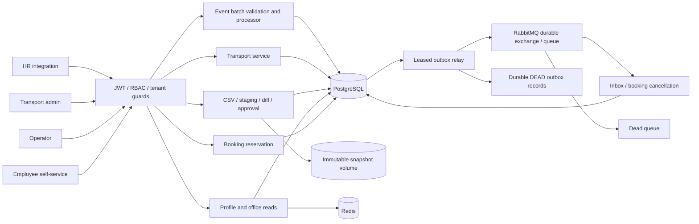
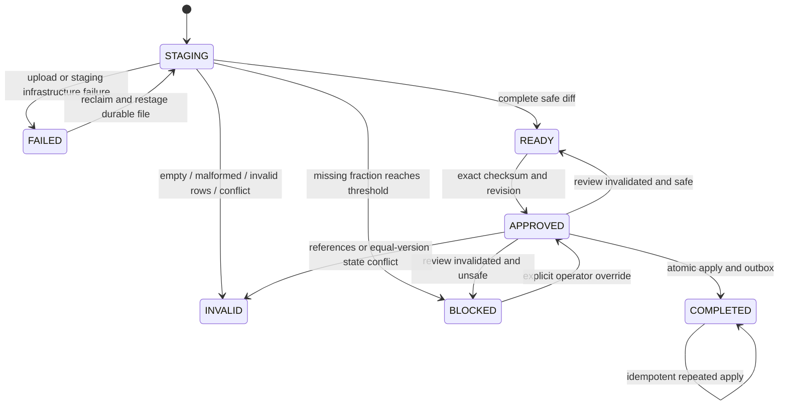
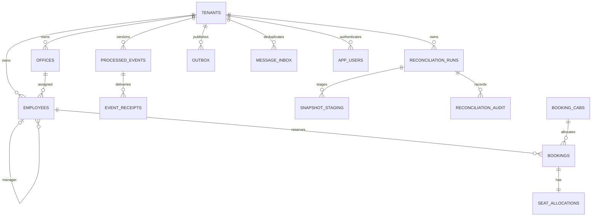

# Architecture and schema



```mermaid
sequenceDiagram
  participant HR
  participant API
  participant DB as PostgreSQL
  participant Relay
  participant Rabbit
  participant Booking
  HR->>API: HR event with eventId / sourceVersion
  API->>DB: Begin READ COMMITTED; lock tenant
  API->>DB: Check receipt and canonical version
  alt duplicate or stale
    API->>DB: No employee/outbox mutation
  else newer valid event
    API->>DB: Explicit HR mutation + receipt + version + outbox
  end
  API->>DB: Commit
  API-->>HR: Per-record safe result
  Note over DB,Relay: Process may die here; pending outbox survives
  Relay->>DB: SKIP LOCKED claim with lease/token; commit
  Relay->>Rabbit: Persistent mandatory publish
  Rabbit-->>Relay: Confirm
  Note over Relay,Rabbit: Death here may produce duplicate delivery
  Relay->>DB: Fenced mark PUBLISHED
  Rabbit->>Booking: EMPLOYEE_DEACTIVATED
  Booking->>DB: Begin; inbox dedup + cancellations + seat release
  Booking->>DB: Commit
  Booking-->>Rabbit: Ack
```





Flyway V1..V9 are authoritative; Hibernate only validates. All employee/reference/booking identities include tenant. Unique HR identity is `(tenant_id,external_employee_id)`; canonical version is `(tenant_id,external_employee_id,source_version)`; event delivery key is `(tenant_id,event_id)`; inbox key is `(tenant_id,consumer,event_id)`. Composite office, manager, booking and cab foreign keys prevent cross-tenant associations. Seat allocations additionally bind the booking's cab.

Indexes support employee active/manager/office lookups, staging identity and valid buckets, pending outbox scans, and confirmed future bookings. Snapshot staging intentionally permits duplicate external IDs so every input row can be retained and duplicates detected across batches. Invalid rows do not store rejected field values. Reconciliation reports/audits contain counts, safe identifiers, approval evidence and codes rather than personal employee attributes.

See [DESIGN.md](DESIGN.md) for transaction ordering, semantics, cache coherence and failure recovery; [docs/audit.md](docs/audit.md) for findings and verified limitations.

```mermaid
sequenceDiagram
  participant Operator
  participant API
  participant File as Durable CSV volume
  participant DB as PostgreSQL
  participant Recovery
  Operator->>API: Create run with exact checksum / cutoff
  API->>DB: Persist run
  Operator->>API: Stream CSV
  API->>File: Bound size, hash bytes, atomic verified artifact
  loop Fixed-size batches
    API->>DB: Check lease token, insert staging, validate references, commit
  end
  Note over API,Recovery: If process dies, expired lease can be reclaimed
  Recovery->>File: Recheck checksum
  Recovery->>DB: Clear old staging and restage same run
  API->>DB: Duplicates / per-row versions / bucket diff / safety brake
  API-->>Operator: READY or BLOCKED report; no employee mutation
  Operator->>API: Approve exact run/checksum/revision; explicit override if blocked
  API->>DB: Lock tenant; verify roster/policy review; persist approval
  Operator->>API: Apply approved run
  API->>DB: Lock tenant; revalidate approval evidence
  API->>DB: One transaction: guarded HR changes + audit + outbox + COMPLETED
  API-->>Operator: Completed, or REVIEW_REQUIRED without employee changes
```
